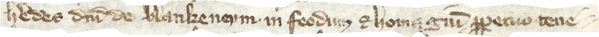
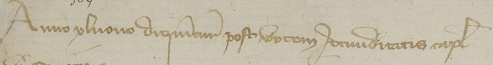
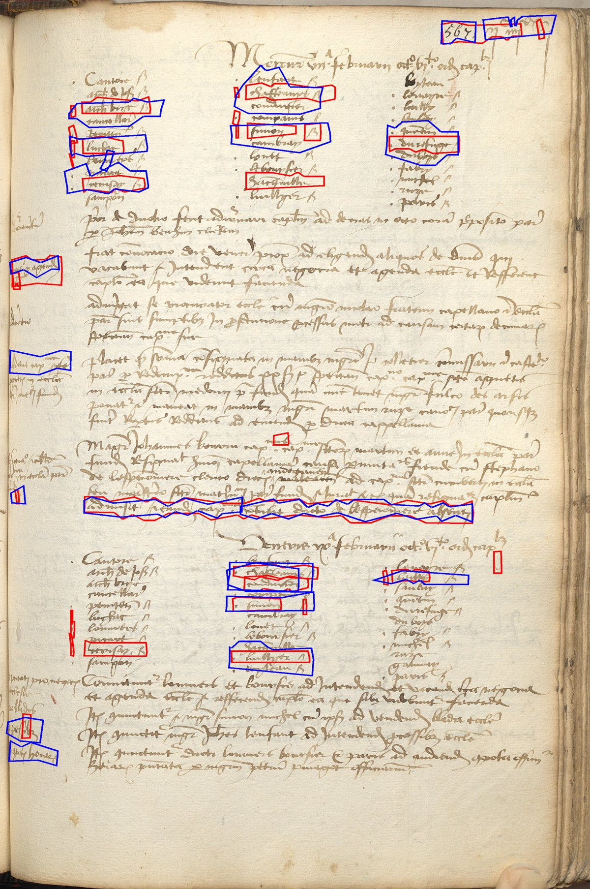

# Summary Research

AI disclaimer: I used Claude to help to compile the tables; I chose the papers and wrote up the findings.

This document has two parts:

- **Part 1: Research.** What papers and tool documentation say about each step.
- **Part 2: Spike #22.** What happened when we tested the models ourselves, on real medieval pages.

## Scope

Research and datasets cover mostly European manuscripts in Latin script (medieval and early modern)

## Pipeline Proposal

page image → find the lines → read each line → translate the text

Other option would be one VLM that looks at the whole page and writes the text directly.

# Part 1: Research

## 1. Find the lines Task

Model gets the whole page and marks where each line of text is.Reading models only read one line at a time, so this step is necessary.

### Findings

| Paper | Model | Architecture | Manuscripts used | How well it worked | Available? | Output |
| --- | --- | --- | --- | --- | --- | --- |
| Kiessling et al. 2019 + Kraken docs | Kraken segmenter | U-Net + rules | Arabic/Persian manuscripts; Latin-script archives 1470–1930 | Found almost all lines on simple pages; weaker on margins and decorated text | Yes | Baseline + outline, straightened line images |
| Grüning et al. 2019 | ARU-Net | U-Net + attention + rules | 11th–20th c. archives, incl. medieval Latin | Found almost all lines on simple pages; still good on complex pages | Code on GitHub | Baseline |
| Alberti et al. 2019 | Segmentation + seam carving | ResNet-18 + rules | 11th c. Latin, 14th c. Italian | Near perfect on medieval pages | Code on GitHub | Line outlines |
| Kiessling 2022 | CurT | Transformer | European archives, Latin script | Good, slightly below the others | Not stated | Baseline (curve) |

Note: Kraken's segmenter was not tested on medieval Latin in the paper.

- Papers report very good results on simple single-column pages.
- Notes in the margins are hard to find.
- big decorated letters and multiple columns or text that is slanted make it harder.
- Most methods use a U-Net: a fully cnn that labels every pixel as "part of a line" or "not a line". Rules then turn this into line positions. Each line is cut out of the original page as its own image, and these line images go to the transcription model.
- Kraken is an open-source tool that does this, free, has pre-trained models, saves lines together with their positions.

suggestion: use Kraken for line finding. Start with its pretrained model and only train it further if it doesn't work well on our pages.

## 2. Reading the text (transcription) Task

Model gets image of a line (from the line finding): handwritten text recognition (HTR). Quality is measured with the character error rate (CER), (the percentage of characters that are wrong).

### Findings

| Paper | Model | Architecture | Manuscripts used | How well it worked | Available? | Needs lines cut first? |
| --- | --- | --- | --- | --- | --- | --- |
| Meoded 2025 | TrOCR | Transformer encoder–decoder | 16th c. Latin, one writer | About 2 wrong characters per 100 after fine-tuning (only one writer) | Yes | Yes |
| Torres Aguilar & Jolivet 2023 | CNN + LSTM (runs in Kraken) | CNN + BiLSTM | 12th–15th c. Latin and French, many writers | 6–17 wrong characters per 100 on new manuscripts; clearly better after fine-tuning on 10 pages | Yes | Yes |
| Semnani et al. 2025 | CHURRO | Vision-language model | 99k pages, 46 languages | Roughly 30 wrong characters per 100 on handwriting; sometimes invents text | Yes | No |

- CNN + LSTM (e.g. Kraken models): the CNN picks up the stroke shapes, and the LSTM reads them from left to right. Reads one line at a time, so it needs line finding first. Pretrained medieval models exist and can be fine-tuned on a few pages.
- Transformer (e.g. TrOCR): the encoder looks at the line image, and the decoder writes the text. Also reads one line at a time. Accurate after fine-tuning, but this was tested on a single writer and not multiple.
- VLM (e.g. CHURRO): reads the whole page at once, so no line finding needed. But it gives no line positions, makes more errors on handwriting, and hallucinates.

- Specialized smaller models perform better than big general ones; the model has to match the script.
- Fine-tuning works with little data.
- VLMs are more prone to hallucination, a risk better avoided for history students.

suggestion: use a specialized line model that is already trained on medieval Latin, and fine-tune it on our pages. We can decide between the Kraken-style and the TrOCR-style model after testing both on a few pages.

### PyLaia

Our professor suggested PyLaia instead of Kraken's own reading model. Kraken still does the line finding.

- PyLaia is an open-source HTR toolkit built on PyTorch, maintained by Teklia.
- Same model type as Kraken's reading model: CNN + BiLSTM, trained with CTC on line images and their text. CTC means the training data only needs the text of each line, not where each letter is.
- Reads one line at a time, so it needs line finding first (Kraken).
- Can add a character language model (n-gram) when decoding. It predicts which characters are likely to come next and fixes some reading errors. Teklia reports about 12% lower CER on average with it.
- Gives a confidence score per line, useful to flag lines a person should check.

## 3. Translation

The Latin text from gets translated into a modern language

### Findings

| Paper | Model | Architecture | Texts used | How well it worked | Available? | Key point for us |
| --- | --- | --- | --- | --- | --- | --- |
| Bui et al. 2026 | HTR model + GPT-4o | Specialized HTR + LLM that sees image and text | Medieval manuscripts, Latin → English | Moderate: meaning often right, but details missing or wrong | Paid | Simplest setup worked best |
| Rosu 2025 | LITERA | Chain of LLM calls | Clean Latin → English | Good on clean text | Paid; free version weaker | Literal translation works well |
 | Bui et al. 2025 | Opus-MT | Transformer | Clean Latin → English | Moderate: meaning often right, but details missing or wrong | Free | Works on clean text, but not on messy text |

- one paper matched our pipeline for medieval Latin manuscripts: a specialized reading model, then an LLM that gets both the image and the transcription and translates it.
- Translation of medieval manuscripts is still hard: old Latin, abbreviations, and reading errors from the transcription step.
- A line on a manuscript page ends wherever the page ends, not where the sentence ends. So one line is often a fragment
- free open-source model fine-tuned on Latin is possible, but worse than paid
- All papers only translated into English. French or German isn't tested anywhere.
- LLMs sometimes refused to translate very noisy text, sometiemes fluent translations were produced but with  wrong translations
- One paper (LITERA) shows that a literal translation, close to the Latin structure, works well and is easier to check.

# Part 2: Spike #22, testing on real pages

Tested on 2026-10-13/14 on a MacBook Air (CPU only, no graphics card).

## 4. Goal

Two questions:

1. **Finding the lines:** does Kraken's pretrained line finder find the lines on medieval pages well enough?
2. **Reading the lines:** which pretrained reading model reads them best, and is it good enough for Manulator?

## 5. Test data

A reading model gets **one line**: one line of handwriting, cut out of a page as a small image. For every test line we also have its **correct text**, typed by an expert. We compare the model's text with that correct text.

We tested on two document types, taken from two public datasets:

| Document type | Dataset | What it is | What we used |
| --- | --- | --- | --- |
| Charters | **MLH** (Monumenta Luxemburgensia Historica), taken from the TRIDIS collection on Hugging Face | Legal documents from medieval Luxembourg (land sales, gifts, privileges), 12th–16th c., Latin | 102 lines (all Latin lines in the TRIDIS test part) |
| Registers | **e-NDP** (electronic Notre-Dame de Paris), from Zenodo | Meeting notes of the clergy of Notre-Dame cathedral in Paris, 1326–1504, Latin, fast handwriting | 200 lines, picked at random (for reading); 20 whole pages of register LL 123 (for line finding) |

Both datasets write abbreviations out in full (*dominum*, not *dñm*).

One line of each type:

**Charter (MLH):** neat, even writing.

*heredes domini de Blankeneym in feodum et homagium perpetuo tene-*

**Register (e-NDP):** fast, crowded writing.

*Anno xl nono die mercurii post vocem Jocunditatis capitulantibus*

**Fairness: no model was trained on our test data.**

- We checked what each model was trained on (see section 6).
- CATMuS, the training data of Kraken CATMuS, contains 5 of the Notre-Dame registers. We found the overlapping pages by comparing texts and left them out, plus every page within 10 page numbers of them as a safety distance.
- MLH is not in any model's training data.

**Checking our own code first.** Before testing, we made sure our code works. PyLaia's makers say it gets 8.35% CER on HOME-Alcar (a dataset of medieval charter copies). We ran PyLaia on 200 HOME-Alcar lines with our own setup (our code that prepares the line images, our PyLaia settings, and our code that counts mistakes) and got 6.4%. That is close, so our setup works correctly. (HOME-Alcar is not used as test data, because PyLaia was trained on it.)

## 6. Models tested

**Finding the lines:** Kraken's pretrained line finder (a U-Net that scores every pixel, then rules turn the scores into lines). Input: a page photo. Output: an outline for each line.

**Reading the lines:** input: one line image. Output: its text. There are really only two kinds of model: **CNN + BiLSTM + CTC** (Kraken's reader and PyLaia) and **Transformer** (TrOCR).

| Model | Type | Trained on | Note |
| --- | --- | --- | --- |
| Kraken CATMuS Medieval | Kraken (CNN + BiLSTM + CTC: a CNN looks at the stroke shapes, a BiLSTM reads them from left to right, CTC turns that into letters) | CATMuS medieval (HTRomance collections) | Kraken's own reader; writes abbreviations with their marks |
| Teklia/pylaia-home-alcar | PyLaia (CNN + BiLSTM + CTC: the same kind of model as Kraken's reader, built with Teklia's toolkit) | Himanis (French) + HOME-Alcar (Latin), medieval | lines resized to 128 px height |
| Teklia/pylaia-home-alcar + language model | PyLaia (as above, plus a 6-gram character language model that knows which letters usually follow each other) | same, plus the text of HOME-Alcar | the language model helps choose between possible readings |
| dh-unibe/trocr-medieval-escriptmask | TrOCR (Transformer: an encoder looks at the whole line image, a decoder writes the text piece by piece, like a chatbot) | CREMMA, HIMANIS, Itinera Nova, Königsfelden charters | University of Bern, generic model for medieval Latin scripts |

## 7. Test rules (fixed before testing)

**Finding the lines**

- Kraken's lines are compared with the true lines drawn by experts.
- A line counts as found when Kraken's outline and the true outline overlap enough (IoU of 0.5 or more: the shared area divided by the total area of both).
- Recall = share of true lines found. Precision = share of Kraken's lines that are real lines.

**Reading the lines**

- All models read the same test lines. These lines were cut out by people, not by Kraken, so reading is tested on its own.
- Errors are counted the same way for every model: CER, wrong letters per 100, over all lines of a document type.
- Before counting mistakes, both texts (the correct one and the model's) are cleaned the same way, so only real reading mistakes count:
  - only letters and spaces are kept; punctuation and symbols are removed
  - capital letters become small letters
  - letters with accents become normal letters (ů becomes u)
  - j becomes i, and v becomes u, because medieval scribes did not tell these letters apart
- Abbreviations still count as mistakes. Our correct texts write words out in full (dominum), and Manulator needs full words for translation. If a model writes the short form (dñm), we mention it next to the results.
- A model is usable if its CER is below 10%. At this level a reader can still correct the text quickly, and good models reach it on new manuscripts (see the research table in section 2).
- Speed is measured as seconds per line, on the same MacBook Air, without a graphics card.

## 8. Results: finding the lines

Kraken on the 20 e-NDP register pages:

| Measure | Result |
| --- | --- |
| Real lines found (recall) | 91.4% |
| Found lines that are real (precision) | 84.5% |
| F-score | 0.88 |

- Most mistakes are in the columns of names (attendance lists), in notes in the left margin, and at the page number in the top corner.
- Kraken often cuts small pieces off line edges (dots and crosses next to names) as extra lines.
- Often Kraken found a line, but its outline overlaps the expert's outline by less than half. Then it counts as both missed and extra. So these numbers are a bit too harsh.
- Right-hand pages are worse than left-hand pages (about 10 vs 5 missed lines per page).

The worst page (LL123_0016_Right). Blue = true lines Kraken missed, red = Kraken lines that match no true line:

## 9. Results: reading the lines

CER on the 102 MLH charter lines and the 200 e-NDP register lines (wrong letters per 100; usable below 10%):

| Model | Charters (MLH) | Registers (e-NDP) | Seconds per line |
| --- | --- | --- | --- |
| PyLaia HOME-Alcar | 8.6% ✅ | 28.6% | 0.3–0.5 |
| PyLaia HOME-Alcar + language model | 8.4% ✅ | 30.3% | 0.4 |
| TrOCR escriptmask | 10.6% | 36.1% | 10 |
| Kraken CATMuS | 26.5% | 46.4% | 0.1 |

- PyLaia is the best on both document types, and fast.
- The language model (trained on charter text) helps a little on charters and hurts on registers.
- Kraken CATMuS writes abbreviations with their marks (⁊ for "et"), while our test data writes words out in full. Part of its high CER comes from this, but Manulator needs written-out words for translation, so it counts.
- TrOCR is 20–40 times slower than PyLaia on a laptop.
- Typical register mistakes: letters that look alike in fast handwriting (c/t, n/u) and register-specific abbreviations the models never learned.

**Example: what each reader wrote for the same two lines.**

The charter line (MLH):

| Reader | Text |
| --- | --- |
| Correct text | heredes domini de Blankeneym in feodum et homagium perpetuo tene- |
| PyLaia HOME-Alcar | heredes domini de Blankzeneym, in feodum ehomagium perpetuo tene¬ |
| PyLaia HOME-Alcar + language model | heredes domini de Blanzene in feodum homagium perpetuo tene¬ |
| TrOCR escriptmask | heredes domini de Blauxencyni in feodum et homagium perpetuo tenere |
| Kraken CATMuS | hedes dñi de blankeneym. in feodum ⁊ homa guĩ ꝓpetuo tene |

All readers get most words right; they differ mainly on the place name *Blankeneym*. Kraken CATMuS writes the abbreviations (*dñi*, *⁊*, *ꝓpetuo*), which counts as mistakes.

The register line (e-NDP):

| Reader | Text |
| --- | --- |
| Correct text | Anno xl nono die mercurii post vocem Jocunditatis capitulantibus |
| PyLaia HOME-Alcar | Anno Yluono diquitur, post votem utiuditatis captus |
| PyLaia HOME-Alcar + language model | anno pluono diquitur post vocem utuditatis captus |
| TrOCR escriptmask | anno yliovo dicuntur post Wycem . In judicatis capellani . |
| Kraken CATMuS | AAnno  luono diquitit poest scotom Aocuudicatis mpł |

On the register line every reader gets most words wrong. TrOCR writes real Latin words that are not on the page (*capellani*), the risk described in section 2.

## 10. Results: both steps together

Full pipeline on 3 e-NDP pages: Kraken finds the lines, PyLaia reads them, and the text of the whole page is compared with the correct text. For comparison, the same pages read from lines cut out by people:

| Page | Lines cut by people | Lines found by Kraken |
| --- | --- | --- |
| LL123_0003_Left | 29.5% | 31.1% |
| LL123_0009_Left | 33.7% | 43.0% |
| LL123_0016_Right | 43.6% | 48.8% |

Most mistakes come from reading; Kraken's line finding adds about 2 to 9 points.

## 11. Recommendation

- **Line finding:** use Kraken. It is good enough to start; name lists, margin notes and split lines need attention later (fine-tuning or manual correction in Manulator).
- **Reading:** use **PyLaia HOME-Alcar**. It was the best on both document types and fast.
- **Charters:** usable as it is (8.4–8.6%).
- **Registers:** not usable yet (28.6%). PyLaia needs fine-tuning on register pages (follow-up task).
- Users will always need to check and correct the text, even on charters (about 1 wrong letter in 12).

## 12. Limitations

- Only two document types (charters and registers).
- Small samples (102 and 200 lines), so small differences between models may be chance.
- The e-NDP lines were cut out as simple rectangles.
- The line-finding measure counts a found line as missed when its outline differs too much from the expert's.
- The CATMuS overlap check could only use lines without abbreviations; we skipped nearby pages as a safety distance.

# Sources

### Line finding
- Rabaev & Litvak (2025): Survey of text line segmentation and baseline detection in historical documents. *IJDAR*.
- Kiessling, Stökl Ben Ezra & Miller (2019): BADAM, a dataset for baseline detection in Arabic-script manuscripts (basis of Kraken's line finding). *HIP '19*.
- Kraken documentation: <https://kraken.re>
- eScriptorium documentation: <https://escriptorium.readthedocs.io>

### Transcription
- Meoded (2025): HTR of historical manuscripts using transformer-based models (TrOCR). *arXiv*.
- Torres Aguilar & Jolivet (2023): HTR for documentary medieval manuscripts. *JDMDH*.
- Semnani et al. (2025): CHURRO, a vision-language model for historical text recognition. *arXiv*.

### PyLaia and models
- Teklia (2024): Improving automatic text recognition with language models in the PyLaia open-source library. *ICDAR 2024*, arXiv 2404.18722.
- PyLaia code: <https://github.com/jpuigcerver/PyLaia>
- Model pages: <https://huggingface.co/Teklia/pylaia-home-alcar>, <https://huggingface.co/dh-unibe/trocr-medieval-escriptmask>, CATMuS Medieval Kraken model: <https://zenodo.org/records/21488839>

### Translation
- Bui et al. (2026): Evaluating translation pipelines for medieval Latin manuscripts. *arXiv*.
- Rosu (2025): LITERA, LLM-based Latin-to-English translation. *NAACL Findings*.
- Momtaz et al. (2025): Kraken and ByT5 pipeline for early printed books. *Electronics*.

### Test data
- MLH (Monumenta Luxemburgensia Historica), from the TRIDIS dataset: <https://huggingface.co/datasets/magistermilitum/Tridis>
- e-NDP, Notre-Dame de Paris chapter registers (CC BY 4.0): <https://zenodo.org/records/7575693>. The register images in this document come from e-NDP (Archives nationales, CC BY 4.0).
- HOME-Alcar, used only for the setup check: <https://huggingface.co/datasets/Teklia/HOME-Alcar-line>
- CATMuS Medieval, checked for overlap with our test data: <https://huggingface.co/datasets/CATMuS/medieval>
