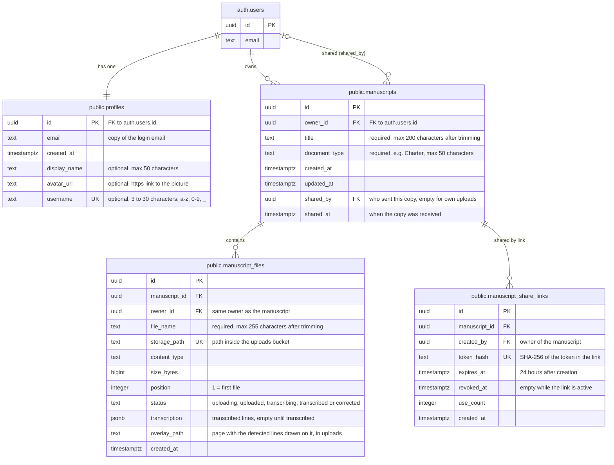

Database

The database runs on [Supabase](https://supabase.com) (managed PostgreSQL + Auth).
Supabase Auth handles sign up, log in and passwords in its own `auth` schema.
Our own tables live in the `public` schema.

The SQL for our four tables is in Setup SQL at the bottom of this page.
Run it in order on a new Supabase project, then configure Auth and Storage as described below.
The SQL recreates the tables and their rules; it does not restore existing users, rows or uploaded files.

Schema



`public.profiles`

One row per registered user. Created automatically at sign up; the app never inserts rows itself.

| Column       | Type          | Notes |
| ------------ | ------------- | ----- |
| `id`         | `uuid`        | Primary key. Same id as `auth.users.id`. Deleted together with the user (`ON DELETE CASCADE`). |
| `email`      | `text`        | Copy of the login email, kept in sync by a trigger. Not null. |
| `created_at` | `timestamptz` | When the profile was created. Defaults to `now()`. |
| `display_name` | `text` | Name shown in the app. Optional (can be empty), max 50 characters. Set at sign up or edited later by the user. |
| `avatar_url` | `text` | Link to the profile picture (e.g. a `.webp` image). Optional, must start with `https://`. Only the link is stored, not the image. |
| `username` | `text` | Unique name other users share manuscripts with. 3 to 30 characters: lowercase letters, digits and `_`. Set at sign up (saved in lowercase) or later on the profile page. Empty for accounts created before sharing existed, until the user picks one. |

`public.manuscripts`

One row per manuscript in a user's library. A manuscript groups uploaded files, like a folder.
A user can create several manuscripts, and each manuscript can contain several files.

| Column | Type | Notes |
| ------ | ---- | ----- |
| `id` | `uuid` | Primary key. Generated automatically. |
| `owner_id` | `uuid` | Defaults to the logged in user's `auth.uid()`. References `auth.users.id`; deleting the user deletes their manuscripts. |
| `title` | `text` | Name shown in the library. Required; must contain 1 to 200 characters after trimming. |
| `document_type` | `text` | What kind of document it is, chosen by the user when uploading, e.g. `Charter`, `Register`, `Letter`. Free text; must contain 1 to 50 characters after trimming. Defaults to `Other`. |
| `created_at` | `timestamptz` | When the manuscript row was created. Defaults to `now()`. |
| `updated_at` | `timestamptz` | Defaults to `now()`. A trigger updates it whenever the manuscript row changes. Changing its file rows alone does not update this timestamp. |
| `shared_by` | `uuid` | For a copy received through sharing: the user who sent it. Empty for manuscripts the user uploaded. References `auth.users.id`; set to empty if the sender deletes their account, the copy itself stays. Only the backend sets it. |
| `shared_at` | `timestamptz` | When the shared copy was received. Empty for own uploads. |

The pair `(id, owner_id)` is unique so the files and share links tables can check both the manuscript and its owner.
A check refuses a copy shared with its own owner, and a copy that has a sender but no date.
Indexes support listing a user's manuscripts newest first and searching within titles (`pg_trgm`).

`public.manuscript_files`

One row per uploaded file belonging to a manuscript. This table stores the file's details and location;
the file itself belongs in the `uploads` Storage bucket.

One uploaded image or PDF creates one file row. A PDF containing several pages still has one
file record and one file-level status. Separate page records would be needed to track each PDF
page independently. The application can collect related file rows into an array for display;
an array column is not needed in the database.

| Column | Type | Notes |
| ------ | ---- | ----- |
| `id` | `uuid` | Primary key. Generated automatically. |
| `manuscript_id` | `uuid` | The manuscript this file belongs to. Required. |
| `owner_id` | `uuid` | Defaults to `auth.uid()`. Must match the manuscript's owner through the composite foreign key. |
| `file_name` | `text` | Original uploaded name. Required; must contain 1 to 255 characters after trimming. Can be renamed later. |
| `storage_path` | `text` | Unique object path inside `uploads`, not a full URL. For example, `<owner_id>/<manuscript_id>/<file>.jpg`. The SQL does not enforce this folder layout. |
| `content_type` | `text` | Must be `image/jpeg`, `image/png` or `application/pdf`. |
| `size_bytes` | `bigint` | File size in bytes. Must be greater than zero. The current backend's 20 MB limit is separate from this database check. |
| `position` | `integer` | File order inside the manuscript, starting at 1. Can be changed later. Positions are not required to be unique. |
| `status` | `text` | Processing step of the page: `uploading`, `uploaded`, `transcribing`, `transcribed` or `corrected`. Defaults to `uploaded`. |
| `transcription` | `jsonb` | Transcribed lines, saved by the backend after the ML service has read the page. Empty (`NULL`) until then. Each line: `{"index", "text", "bbox", "baseline", "boundary"}`. |
| `overlay_path` | `text` | Path inside `uploads` of the overlay image (the page with the detected lines drawn on it), e.g. `<owner_id>/overlays/<file>.jpg`. Saved with the transcription; the old image is deleted when the page is transcribed again. Empty until then. |
| `created_at` | `timestamptz` | When the file row was created. Defaults to `now()`. |

The foreign key `(manuscript_id, owner_id)` references `manuscripts(id, owner_id)`.
It prevents attaching a file to another user's manuscript. Deleting a manuscript deletes its file rows
with `ON DELETE CASCADE`; deleting the actual Storage objects is a separate operation.

Indexes support loading a manuscript's files in position order, listing a user's files,
and searching within file names (`pg_trgm`).

`public.manuscript_share_links`

One row per share link a user created for one of their manuscripts. Anyone logged in who opens a valid link
can add a copy of the manuscript to their own library. Sharing always makes a copy: the recipient gets new
`manuscripts` and `manuscript_files` rows and their own files in `uploads`, so the copy survives if the owner
deletes the original. Only the backend reads and writes this table.

| Column | Type | Notes |
| ------ | ---- | ----- |
| `id` | `uuid` | Primary key. Generated automatically. |
| `manuscript_id` | `uuid` | The manuscript the link shares. Deleting the manuscript deletes its links. |
| `created_by` | `uuid` | The user who created the link. Must be the manuscript's owner (composite foreign key, like `manuscript_files`). |
| `token_hash` | `text` | SHA-256 of the random token in the link, as 64 hex characters. Unique. The token itself is never stored. |
| `expires_at` | `timestamptz` | The link stops working after this time. Defaults to 24 hours after creation. Cannot be changed later. |
| `revoked_at` | `timestamptz` | Set when the owner revokes the link. Empty while the link is active. |
| `use_count` | `integer` | How many times someone added the manuscript to their library with this link. Defaults to 0. |
| `created_at` | `timestamptz` | When the link was created. Defaults to `now()`. |

A link is valid when `revoked_at` is empty and `expires_at` is in the future. An index supports listing the
links of one manuscript in the share dialog.

File statuses

Each uploaded file has its own status. Values are stored in lowercase and displayed with
capitalised labels in the application.

| Stored value | Display label | Meaning |
| ------------ | ------------- | ------- |
| `uploading` | Uploading | File transfer is in progress. |
| `uploaded` | Uploaded | The file has been stored successfully. |
| `transcribing` | Transcribing | Recognition is processing the file. |
| `transcribed` | Transcribed | The generated transcription has been saved. |
| `corrected` | Corrected | The user's corrections have been saved. |

The intended progression is:

```text
Uploading → Uploaded → Transcribing → Transcribed → Corrected
```

Status is required and defaults to `uploaded`. Existing file records receive that default when
the column is added. If the application creates a record before the transfer finishes, it must
explicitly set `uploading`, then change it to `uploaded` after success.

The database validates the allowed values; the application controls when they change. When a
"Transcribe" run finishes, the backend saves the lines in `transcription`, the overlay image in
the bucket (its path in `overlay_path`) and sets the status to `transcribed`. The frontend's `upload-failed` error state is not one of the five stored statuses.

To add the transcription columns to an existing project, run:

```sql
ALTER TABLE public.manuscript_files ADD COLUMN IF NOT EXISTS transcription JSONB;
ALTER TABLE public.manuscript_files ADD COLUMN IF NOT EXISTS overlay_path TEXT;
GRANT UPDATE (transcription, overlay_path, status) ON TABLE public.manuscript_files TO service_role;
NOTIFY pgrst, 'reload schema';
```

Database status validation was tested on 16 October 2026. All 11 checks passed: the default value,
saving and reading all five statuses, rejecting `finished`, an empty string, uppercase `UPLOADED`
and `NULL`, and confirming that the temporary test manuscript and file were rolled back.
These checks covered status validation, not application integration or user access rules.

Triggers

| Trigger | On | What it does |
| ------- | -- | ------------ |
| `on_auth_user_created` | insert into `auth.users` | Calls `handle_new_user()`, which creates the matching profile row. If a `display_name` or `username` was sent at sign up, it is saved too (the username trimmed and in lowercase). An invalid or taken username makes the sign up fail. |
| `on_auth_user_email_changed` | update of `auth.users.email` | Calls `handle_user_email_change()`, which copies the new email into the profile. |
| `manuscripts_set_updated_at` | before update of `public.manuscripts` | Calls `set_updated_at()`, which sets `updated_at` to `now()`. |

The two Auth trigger functions are `SECURITY DEFINER` with an empty `search_path`.
If profile creation fails during sign up, that sign up fails too. The manuscript timestamp function
runs with the caller's privileges and also has an empty `search_path`.
API execution privileges are revoked for all three functions; they are intended to run as triggers.

Security (Row Level Security)

RLS is enabled on all four public tables. Together with column permissions, it controls which rows
logged in users can reach and which fields they can change.

| Table | What `authenticated` users can do with their own rows |
| ----- | --------------------------------------------------- |
| `profiles` | Read; update only `display_name`, `avatar_url` and `username`. Ownership is checked with `auth.uid() = id`. |
| `manuscripts` | Read, create with a `title`, rename the `title`, and delete. Ownership is checked with `auth.uid() = owner_id`. |
| `manuscript_files` | Read, add a file with `manuscript_id`, `file_name`, `storage_path`, `content_type`, `size_bytes`, `position` and `status`; update only `file_name`, `position` and `status`; delete. Ownership is checked with `auth.uid() = owner_id`. |
| `manuscript_share_links` | Nothing. RLS is on without policies and all rights are revoked; only the backend uses the table. |

Users cannot set `shared_by` or `shared_at` themselves, so nobody can fake a "Shared by" label.
Usernames are looked up by the backend (exact match only), because users can only read their own profile.

`anon` (not logged in) has no access to these tables. Profiles are created by the Auth trigger.
Users cannot change their profile's `id`, `email` or `created_at`, and cannot insert or delete profiles.
They cannot supply or change manuscript/file owner IDs through the granted columns;
the database fills them from the logged in user.
When we add another editable profile field, add it to `GRANT UPDATE (...) ... TO authenticated`.

These rules apply to requests made with the user's access token. The backend secret key bypasses RLS,
so backend operations using that key must check the user's identity and ownership themselves.

Using the profile in the app

The current app sends registration requests through the FastAPI backend. The backend includes
`display_name` (and, with sharing, `username`) in Supabase Auth metadata, and the trigger saves them in the profile.
The frontend reads the profile and edits the display name through Supabase's REST API,
using the publishable key and the logged in user's access token.

The equivalent Supabase JavaScript calls below illustrate the database behaviour:

```ts
await supabase.auth.signUp({
  email,
  password,
  options: { data: { display_name: "Alice", username: "alice" } },
});
```

The profile page saves the name and the picture link this way (the picture file itself is uploaded first, see Profile picture uploads):

```ts
await supabase.from("profiles").update({ display_name, avatar_url }).eq("id", user.id);
```

Library integration status

The `manuscripts` and `manuscript_files` tables are already present in the Supabase project,
including the file status column. The library is loaded from the database:

- `POST /api/upload-manuscripts` creates a `manuscripts` row, uploads the file to Supabase Storage
  and saves one `manuscript_files` row for it. A PDF is converted first: only its first page is
  kept, rendered as a PNG (300 DPI, longest side at most 4000 px). The stored file, its
  `content_type` (`image/png`), its name (`.png`) and its size are those of the image, and the
  original PDF is not stored. A PDF that cannot be read (damaged, empty or password protected)
  is rejected with status 422.
- `GET /api/upload-manuscripts` returns the logged in user's manuscripts, newest first. Each entry
  contains the manuscript's first file (lowest `position`), its saved `status` and a temporary
  link to the file, valid for 1 day. The backend uses the admin client, which ignores RLS, so it
  filters by `owner_id` itself.
- If the links cannot be created, the entries are still returned with an empty `url`. The
  frontend then shows a placeholder and asks the user to reload the page.
- `PATCH /api/upload-manuscripts/{id}` changes the `title` and/or the `document_type` of one of
  the user's manuscripts. Both are optional, but at least one must be sent. They are trimmed and
  follow the same rules as at upload (title 1 to 200, document type 1 to 50 characters), otherwise
  the status is 422. It returns the saved `id`, `title` and `document_type`. A manuscript that does
  not exist or belongs to someone else returns 404.
- `DELETE /api/upload-manuscripts/{id}` deletes the manuscript, its file rows and its files in Storage.
- `PATCH /api/upload-manuscripts/{id}/lines/{index}` replaces the `text` of one line in
  `manuscript_files.transcription` with the researcher's correction and sets `status` to
  `corrected`. The line's other fields are kept, and the model's original text is overwritten:
  only the latest text is stored. No new column is needed. See `backend/README.md` for the
  request, response and status codes.

`manuscript_files.status` is read and shown in the badges and filters. The backend sets it to
`transcribed` after a transcription run and to `corrected` after a saved line correction.

Storage

The Supabase project has two buckets:

| Bucket | Visibility | Purpose |
| ------ | ---------- | ------- |
| `uploads` | Private | Manuscript files. `manuscript_files.storage_path` identifies an object in this bucket. |
| `avatars` | Public | Profile pictures. `profiles.avatar_url` stores the image's HTTPS URL. |

Public avatar URLs can be viewed by anyone with the URL. Private manuscript downloads require
authorized access or a signed URL. Table RLS and Storage access rules are configured separately.
The `avatars` bucket has access policies, so the browser uploads profile pictures directly
(see Avatar storage). The `uploads` bucket has no policies yet.

Deleting a manuscript or user removes the related database rows through the foreign keys,
but it does not remove the actual uploaded objects. File cleanup must use the
[Supabase Storage API](https://supabase.com/docs/guides/storage/management/delete-objects).
Keep the object paths before deleting their metadata so the app can clean up the files.

Sharing needs no extra bucket. A shared copy's files are copied inside `uploads` into the recipient's
folder (`<recipient_id>/<new_manuscript_id>/...` and `<recipient_id>/overlays/...`), so they belong to
the recipient and are not affected when the owner deletes the original.

Profile picture uploads

The frontend uploads the picture straight to Supabase, with the logged-in user's token
(`frontend/src/features/profile/api/profile.ts`). There is no backend code for it.

1. In the "Change profile picture" dialog the user chooses a picture and positions it (drag,
   arrow keys, zoom). The browser cuts out the part inside the circle, shrinks it to at most
   512 × 512 px and encodes it as WebP (JPEG in browsers that cannot create WebP), see
   `resizeAvatar.ts`.
2. It uploads the file to `avatars/<user id>/avatar`, replacing the previous picture
   (header `x-upsert: true`). Each user has exactly one file, so old pictures never pile up.
3. It saves the public link in `profiles.avatar_url`, with `?v=<time>` at the end so browsers
   load the new picture instead of a cached old one.

Removing the picture first sets `avatar_url` to null, then deletes the file.

The Avatar storage policies only let a user write into the folder named after
their own id. The bucket only accepts WebP and JPEG files up to 1 MB (the resized picture is
much smaller). Supabase checks the declared file type and size, not the image contents.

Setting up a Supabase project

1. **Auth settings** (Dashboard → Authentication → Sign In / Providers):
   - **Email** provider: on.
   - Check **Confirm email**: when enabled, users must confirm their email before password login.
2. **Auth URL Configuration** (Dashboard → Authentication → URL Configuration):
   - Local **Site URL**: `http://localhost:3000`.
   - Add `http://localhost:3000/auth` for email confirmation.
   - Add `http://localhost:3000/auth/reset-password` for password recovery.
   - For a deployed frontend, add the same paths on its actual domain and set the Site URL accordingly.
     These URLs must match the backend's `FRONTEND_URL`; see
     [Supabase's redirect URL guide](https://supabase.com/docs/guides/auth/redirect-urls).
3. **Run the SQL:** open *SQL Editor* and run the four Setup SQL blocks in order:
   profiles, manuscripts, manuscript files, then share links. Run them before registering application users.
4. **Storage:** create `uploads` with **Public bucket off** and `avatars` with **Public bucket on**,
   then run the Avatar storage SQL. It sets the bucket limits and lets users
   upload their own profile picture.
5. **Environment:** fill in the frontend and backend files below, then restart both servers.

Updating an existing project

If the project was set up before `display_name` and `avatar_url` were added, run this once in the *SQL Editor*
instead of the full Setup SQL (new projects don't need it, the Setup SQL below already includes it):

```sql
-- Adds the display name and profile picture to the profiles table
ALTER TABLE public.profiles
    -- name shown in the app (optional, max 50 characters)
    ADD COLUMN display_name TEXT CHECK (char_length(display_name) <= 50),
    -- link to the profile picture, e.g. a .webp image (optional, must be an https link)
    ADD COLUMN avatar_url TEXT CHECK (avatar_url ~ '^https://');

-- Updates the sign up trigger so the display name given at sign up (user metadata) is saved in the profile
CREATE OR REPLACE FUNCTION public.handle_new_user()
RETURNS TRIGGER AS $$
BEGIN
    INSERT INTO public.profiles (id, email, display_name)
    VALUES (
        NEW.id,
        NEW.email,
        nullif(left(trim(NEW.raw_user_meta_data ->> 'display_name'), 50), '')
    );
    RETURN NEW;
END;
$$ LANGUAGE plpgsql SECURITY DEFINER SET search_path = '';

-- Logged in users can edit only these two columns (email and created_at stay protected)
GRANT UPDATE (display_name, avatar_url) ON TABLE public.profiles TO authenticated;

-- Allows users to edit only their own profile data
CREATE POLICY "Users can update own profile"
    ON public.profiles FOR UPDATE
    USING ((select auth.uid()) = id)
    WITH CHECK ((select auth.uid()) = id);
```

If profile pictures cannot be uploaded yet, run the Avatar storage SQL once.

If the library tables have not been created yet, run Library part 1
and then Library part 2. The current project already has both.
Do not rerun table creation or the profile update above when those tables or columns already exist.

Add file statuses

Run this once only if `manuscript_files` already exists and its `status` column is missing.
New projects use the complete Library part 2 script instead.
The current Manulator project already has this change, so it does not need to be run again there.

```sql
BEGIN;

ALTER TABLE public.manuscript_files
    ADD COLUMN status TEXT NOT NULL DEFAULT 'uploaded'
    CONSTRAINT manuscript_files_status_check
    CHECK (status IN (
        'uploading',
        'uploaded',
        'transcribing',
        'transcribed',
        'corrected'
    ));

GRANT INSERT (status), UPDATE (status)
    ON TABLE public.manuscript_files
    TO authenticated;

COMMIT;
```

Add sharing (usernames, shared copies, share links)

Run this once in the *SQL Editor* to add sharing (#214, #215) to an existing project.
New projects don't need it: the Setup SQL below already includes it. It runs in one transaction,
so if anything fails nothing is changed. It does not create a bucket: shared copies go into `uploads`.

```sql
-- Sharing (#214, task #215): usernames, where a shared copy came from, and share links.
-- Run once in the SQL Editor of an existing project. New projects get the same result from the Setup SQL.
BEGIN;

-- 1. Usernames, so people can share with each other

-- unique name to share with: 3 to 30 characters, lowercase letters, digits and _ (optional, so existing users can pick one later)
ALTER TABLE public.profiles
    ADD COLUMN username TEXT UNIQUE CONSTRAINT profiles_username_check CHECK (username ~ '^[a-z0-9_]{3,30}$');

-- The sign up trigger also saves the username sent at sign up (user metadata), trimmed and in lowercase.
-- An invalid or taken username makes the sign up fail, so the backend checks it before signing up.
CREATE OR REPLACE FUNCTION public.handle_new_user()
RETURNS TRIGGER AS $$
BEGIN
    INSERT INTO public.profiles (id, email, display_name, username)
    VALUES (
        NEW.id,
        NEW.email,
        nullif(left(trim(NEW.raw_user_meta_data ->> 'display_name'), 50), ''),
        nullif(lower(trim(NEW.raw_user_meta_data ->> 'username')), '')
    );
    RETURN NEW;
END;
$$ LANGUAGE plpgsql SECURITY DEFINER SET search_path = '';

-- Logged in users can also change their own username (the existing update policy limits it to their own row)
GRANT UPDATE (username) ON TABLE public.profiles TO authenticated;

-- 2. Where a shared copy came from

ALTER TABLE public.manuscripts
    -- who sent this copy; empty for manuscripts the user uploaded, and set to empty if the sender deletes their account
    ADD COLUMN shared_by UUID REFERENCES auth.users(id) ON DELETE SET NULL,
    -- when the copy was received
    ADD COLUMN shared_at TIMESTAMPTZ,
    -- nobody shares a manuscript with themselves, and a copy with a sender always has a date
    ADD CONSTRAINT manuscripts_shared_check
        CHECK (shared_by IS DISTINCT FROM owner_id AND (shared_by IS NULL OR shared_at IS NOT NULL));

-- 3. Share links (valid 24 hours)

-- Creates the share links table, one row per link a user created for one of their manuscripts
CREATE TABLE public.manuscript_share_links (
    -- sets unique id for row
    id UUID PRIMARY KEY DEFAULT gen_random_uuid(),
    -- the manuscript the link shares
    manuscript_id UUID NOT NULL,
    -- the user who created the link, always the owner of the manuscript
    created_by UUID NOT NULL,
    -- SHA-256 of the token in the link, as 64 hex characters; the token itself is never stored
    token_hash TEXT NOT NULL UNIQUE CHECK (token_hash ~ '^[0-9a-f]{64}$'),
    -- the link stops working after this time (24 hours after it was created)
    expires_at TIMESTAMPTZ NOT NULL DEFAULT (now() + interval '24 hours'),
    -- set when the owner revokes the link; empty while the link is active
    revoked_at TIMESTAMPTZ,
    -- how many times someone added the manuscript to their library with this link
    use_count INTEGER NOT NULL DEFAULT 0 CHECK (use_count >= 0),
    -- records when the link was created
    created_at TIMESTAMPTZ NOT NULL DEFAULT now(),
    -- a link cannot expire before it was created
    CHECK (expires_at > created_at),
    -- refuses a link to someone else's manuscript, and deletes the links with the manuscript
    FOREIGN KEY (manuscript_id, created_by) REFERENCES public.manuscripts(id, owner_id) ON DELETE CASCADE
);

-- Speeds up listing the links of one manuscript in the share dialog
CREATE INDEX manuscript_share_links_manuscript_idx ON public.manuscript_share_links (manuscript_id);

-- Only the backend uses this table: no access for the browser. service_role is included because
-- Supabase gives it full access to every new table, which would make the column list below useless.
REVOKE ALL ON TABLE public.manuscript_share_links FROM anon, authenticated, service_role;
-- The backend (secret key) creates, reads, revokes, counts and deletes links, but cannot change
-- a link's manuscript, token or expiry
GRANT SELECT, INSERT, DELETE ON TABLE public.manuscript_share_links TO service_role;
GRANT UPDATE (revoked_at, use_count) ON TABLE public.manuscript_share_links TO service_role;

-- RLS on and no policies: logged in users cannot reach the table even with their own token
ALTER TABLE public.manuscript_share_links ENABLE ROW LEVEL SECURITY;

COMMIT;

-- Lets the Supabase API see the new columns and table right away
NOTIFY pgrst, 'reload schema';
```

Email

Manulator uses [Resend](https://resend.com) with the custom domain `mail.manulator.app` to send
confirmation and password-reset emails. Without a custom domain, Supabase's built-in mail rate-limits
to ~2 emails per hour and only works reliably for team members.

Setup summary (already done)

1. Domain `manulator.app` registered via Name.com (GitHub Student Pack — free for 1 year).
2. DNS records added in Name.com's DNS management (DKIM, SPF x2, DMARC) — verified by Resend.
3. Resend → Supabase integration connected: project = Manulator, domain = `mail.manulator.app`,
   sender = `Manulator <no-reply@mail.manulator.app>`.
4. Supabase **Authentication → SMTP settings** filled in:
   - Host: `smtp.resend.com`, Port: `465`
   - Username: `resend`, Password: Resend API key

Email templates

HTML templates live in `docs/email-templates/`. Paste each one into
**Supabase → Authentication → Email Templates** (replace the default body):

| Template | File | Subject line |
|---|---|---|
| Confirm signup | `confirm-signup.html` | `Confirm your Manulator account` |
| Reset password | `reset-password.html` | `Reset your Manulator password` |

Template variables used: `{{ .ConfirmationURL }}`, `{{ .Email }}`,
`{{ if .Data.display_name }}{{ .Data.display_name }}{{ else }}there{{ end }}`.

Verified badge

`AccountCard.tsx` calls `fetchEmailVerified()` (in `profile.ts`) on mount.
That function hits `GET /auth/v1/user` and returns `Boolean(user.email_confirmed_at)`.
A green **✓ Verified** pill (mt-success colours) or a yellow **Not verified** pill
(mt-warning colours) is shown next to the email address in the Account card.
No database schema change is needed — the field lives on Supabase's auth user object.

Keys and environment variables

Each person creates their own `.env` files with the content below and fills in the values.
These files are git-ignored: never commit them, and never share the secret key in chat.

**Frontend:** create `frontend/.env.local`

```
# Supabase project URL (Dashboard -> Project Settings -> Data API)
NEXT_PUBLIC_SUPABASE_URL=https://your-project-ref.supabase.co
# Supabase publishable key (Dashboard -> Project Settings -> API Keys), safe in the browser because RLS protects the data
NEXT_PUBLIC_SUPABASE_PUBLISHABLE_KEY=your-publishable-key
# FastAPI backend address (optional locally; defaults to http://localhost:8000)
NEXT_PUBLIC_API_BASE_URL=http://localhost:8000
```

**Backend:** create `backend/.env`

```
# Supabase project URL (Dashboard -> Project Settings -> Data API)
SUPABASE_URL=https://your-project-ref.supabase.co
# Supabase secret key (Dashboard -> Project Settings -> API Keys), bypasses RLS so it must only be used in the backend
SUPABASE_SECRET_KEY=your-secret-key
# Frontend address used to build confirmation and password reset links (no trailing slash)
FRONTEND_URL=http://localhost:3000
```

Write each line as `NAME=value` (no quotes or brackets) and restart the dev server after changing a `.env` file.
If you don't have access to the Supabase Dashboard, ask the database owner for the values.

Setup SQL

Run once on a new Supabase project (SQL Editor → paste → *Run*), in the order below.
The scripts create the profiles and library tables, including file statuses and their permissions.
Auth URL settings and Storage buckets must be configured separately as described above.

Profiles

```sql
-- Creates the profiles table, its triggers and security rules (run once on a new Supabase project)

-- Creates the user profiles table linked to Supabase Auth
CREATE TABLE public.profiles (
    -- sets unique id for row
    -- same id as the user in auth.users, the profile is deleted together with the user
    id UUID PRIMARY KEY REFERENCES auth.users(id)
    ON DELETE CASCADE,
    -- copy of the login email (kept in sync by the triggers below)
    email TEXT NOT NULL,
    -- records when the profile was created (NOT NULL prevents rows without a timestamp)
    created_at TIMESTAMPTZ DEFAULT now() NOT NULL,
    -- name shown in the app (optional, max 50 characters)
    display_name TEXT CHECK (char_length(display_name) <= 50),
    -- link to the profile picture, e.g. a .webp image (optional, must be an https link)
    avatar_url TEXT CHECK (avatar_url ~ '^https://'),
    -- unique name to share with: 3 to 30 characters, lowercase letters, digits and _ (optional, so existing users can pick one later)
    username TEXT UNIQUE CONSTRAINT profiles_username_check CHECK (username ~ '^[a-z0-9_]{3,30}$')
);

-- Creates a trigger function to automatically populate public.profiles (the display name and username come from the sign up metadata)
-- An invalid or taken username makes the sign up fail, so the backend checks it before signing up.
CREATE OR REPLACE FUNCTION public.handle_new_user()
RETURNS TRIGGER AS $$
BEGIN
    INSERT INTO public.profiles (id, email, display_name, username)
    VALUES (
        NEW.id,
        NEW.email,
        nullif(left(trim(NEW.raw_user_meta_data ->> 'display_name'), 50), ''),
        nullif(lower(trim(NEW.raw_user_meta_data ->> 'username')), '')
    );
    RETURN NEW;
END;
$$ LANGUAGE plpgsql SECURITY DEFINER SET search_path = '';

-- automated listener, executes handle_new_user()
CREATE OR REPLACE TRIGGER on_auth_user_created
    AFTER INSERT ON auth.users
    FOR EACH ROW
    EXECUTE FUNCTION public.handle_new_user();

-- Keeps public.profiles.email in sync when a user changes their login email
CREATE OR REPLACE FUNCTION public.handle_user_email_change()
RETURNS TRIGGER AS $$
BEGIN
    UPDATE public.profiles SET email = NEW.email WHERE id = NEW.id;
    RETURN NEW;
END;
$$ LANGUAGE plpgsql SECURITY DEFINER SET search_path = '';

-- automated listener, executes handle_user_email_change() only if the email actually changed
CREATE OR REPLACE TRIGGER on_auth_user_email_changed
    AFTER UPDATE OF email ON auth.users
    FOR EACH ROW
    WHEN (OLD.email IS DISTINCT FROM NEW.email)
    EXECUTE FUNCTION public.handle_user_email_change();

-- These functions are only meant to run as triggers, so nobody should be able to call them through the API. Triggers keep working without these privileges.
REVOKE EXECUTE ON FUNCTION public.handle_new_user() FROM PUBLIC, anon, authenticated;
REVOKE EXECUTE ON FUNCTION public.handle_user_email_change() FROM PUBLIC, anon, authenticated;

-- Removes the full access Supabase gives to every new table, logged in users can only read and edit their name, picture and username (rows are created by the triggers)
REVOKE ALL ON TABLE public.profiles FROM anon, authenticated;
GRANT SELECT ON TABLE public.profiles TO authenticated;
GRANT UPDATE (display_name, avatar_url, username) ON TABLE public.profiles TO authenticated;

-- Enables Row Level Security (RLS) to protect user data
ALTER TABLE public.profiles ENABLE ROW LEVEL SECURITY;

-- Allows users to read only their own profile data
CREATE POLICY "Users can view own profile"
    ON public.profiles FOR SELECT
    USING ((select auth.uid()) = id);

-- Allows users to edit only their own profile data
CREATE POLICY "Users can update own profile"
    ON public.profiles FOR UPDATE
    USING ((select auth.uid()) = id)
    WITH CHECK ((select auth.uid()) = id);
```

Library part 1: manuscripts

Saved SQL Editor query name: `library_1_manuscripts`.

Creates the manuscript library entries, including titles, ownership, dates, indexes,
the timestamp trigger and access rules.

```sql

-- Enables fast "contains" search on names, used by the library search
CREATE EXTENSION IF NOT EXISTS pg_trgm WITH SCHEMA extensions;

-- Creates the manuscripts table, one row per manuscript in a user's library
CREATE TABLE public.manuscripts (
    -- sets unique id for row
    id UUID PRIMARY KEY DEFAULT gen_random_uuid(),
    -- the user who owns the manuscript, filled in automatically from the logged in user
    owner_id UUID NOT NULL DEFAULT auth.uid() REFERENCES auth.users(id) ON DELETE CASCADE,
    -- name shown in the library (required, max 200 characters)
    title TEXT NOT NULL CHECK (char_length(trim(title)) BETWEEN 1 AND 200),
    -- kind of document, e.g. Charter, Register, Letter (free text, max 50 characters)
    document_type TEXT NOT NULL DEFAULT 'Other' CHECK (char_length(trim(document_type)) BETWEEN 1 AND 50),
    -- records when the manuscript was created
    created_at TIMESTAMPTZ DEFAULT now() NOT NULL,
    -- records when the manuscript was last changed (kept up to date by the trigger below)
    updated_at TIMESTAMPTZ DEFAULT now() NOT NULL,
    -- who sent this copy; empty for manuscripts the user uploaded, and set to empty if the sender deletes their account
    shared_by UUID REFERENCES auth.users(id) ON DELETE SET NULL,
    -- when the copy was received
    shared_at TIMESTAMPTZ,
    -- lets manuscript_files and manuscript_share_links check that they belong to the manuscript's owner
    UNIQUE (id, owner_id),
    -- nobody shares a manuscript with themselves, and a copy with a sender always has a date
    CONSTRAINT manuscripts_shared_check
        CHECK (shared_by IS DISTINCT FROM owner_id AND (shared_by IS NULL OR shared_at IS NOT NULL))
);

-- Speeds up the library view: a user's manuscripts, newest first
CREATE INDEX manuscripts_owner_created_idx ON public.manuscripts (owner_id, created_at DESC);
-- Speeds up searching by name, also when the searched word is in the middle of the name
CREATE INDEX manuscripts_title_search_idx ON public.manuscripts USING gin (title extensions.gin_trgm_ops);

-- Keeps updated_at current whenever a manuscript is changed
CREATE OR REPLACE FUNCTION public.set_updated_at()
RETURNS TRIGGER AS $$
BEGIN
    NEW.updated_at = now();
    RETURN NEW;
END;
$$ LANGUAGE plpgsql SET search_path = '';

-- automated listener, executes set_updated_at() before every change to a manuscript
CREATE OR REPLACE TRIGGER manuscripts_set_updated_at
    BEFORE UPDATE ON public.manuscripts
    FOR EACH ROW
    EXECUTE FUNCTION public.set_updated_at();

-- This function is only meant to run as a trigger, so nobody should be able to call it through the API
REVOKE EXECUTE ON FUNCTION public.set_updated_at() FROM PUBLIC, anon, authenticated;

-- Removes the full access Supabase gives to every new table, logged in users get only what the library needs
REVOKE ALL ON TABLE public.manuscripts FROM anon, authenticated;
-- Read, create with a title, rename, delete (owner and dates are set by the database)
GRANT SELECT, DELETE ON TABLE public.manuscripts TO authenticated;
GRANT INSERT (title, document_type), UPDATE (title, document_type) ON TABLE public.manuscripts TO authenticated;
-- The backend (secret key) creates, lists, renames and deletes manuscripts for the logged in user.
-- Updating is limited to the two columns the edit form changes.
GRANT SELECT, INSERT, DELETE ON TABLE public.manuscripts TO service_role;
GRANT UPDATE (title, document_type) ON TABLE public.manuscripts TO service_role;

-- Enables Row Level Security (RLS) so users only ever reach their own manuscripts
ALTER TABLE public.manuscripts ENABLE ROW LEVEL SECURITY;

-- Allows users to see, create, rename and delete only their own manuscripts
CREATE POLICY "Users can view own manuscripts"
    ON public.manuscripts FOR SELECT
    USING ((select auth.uid()) = owner_id);
CREATE POLICY "Users can create own manuscripts"
    ON public.manuscripts FOR INSERT
    WITH CHECK ((select auth.uid()) = owner_id);
CREATE POLICY "Users can update own manuscripts"
    ON public.manuscripts FOR UPDATE
    USING ((select auth.uid()) = owner_id)
    WITH CHECK ((select auth.uid()) = owner_id);
CREATE POLICY "Users can delete own manuscripts"
    ON public.manuscripts FOR DELETE
    USING ((select auth.uid()) = owner_id);
```

Library part 2: manuscript files

Saved SQL Editor query name: `library_2_manuscript_files`.

Creates one row per uploaded image or PDF, linked to its manuscript and owner, with file details,
storage path, order, status, indexes and access rules.

```sql

-- Creates the manuscript files table, one row per uploaded file
CREATE TABLE public.manuscript_files (
    -- sets unique id for row
    id UUID PRIMARY KEY DEFAULT gen_random_uuid(),
    -- the manuscript this file belongs to
    manuscript_id UUID NOT NULL,
    -- the user who owns the file, filled in automatically and always the same as the manuscript's owner
    owner_id UUID NOT NULL DEFAULT auth.uid(),
    -- original file name, as uploaded (max 255 characters)
    file_name TEXT NOT NULL CHECK (char_length(trim(file_name)) BETWEEN 1 AND 255),
    -- where the file is kept in the storage bucket, e.g. <owner_id>/<manuscript_id>/<file>.jpg
    storage_path TEXT NOT NULL UNIQUE,
    -- file type, the same list the backend accepts
    content_type TEXT NOT NULL CHECK (content_type IN ('image/jpeg', 'image/png', 'application/pdf')),
    -- file size in bytes
    size_bytes BIGINT NOT NULL CHECK (size_bytes > 0),
    -- order of the file inside the manuscript (1 = first)
    position INTEGER NOT NULL CHECK (position >= 1),
    -- processing step of the page
    status TEXT NOT NULL DEFAULT 'uploaded'
        CONSTRAINT manuscript_files_status_check
        CHECK (status IN ('uploading', 'uploaded', 'transcribing', 'transcribed', 'corrected')),
    -- transcribed lines, saved by the backend after the ML service has read the page
    transcription JSONB,
    -- overlay image (page with the detected lines drawn on it) inside the uploads bucket
    overlay_path TEXT,
    -- records when the file was uploaded
    created_at TIMESTAMPTZ DEFAULT now() NOT NULL,
    -- links the file to its manuscript, refuses a manuscript owned by someone else, and deletes the file with the manuscript
    FOREIGN KEY (manuscript_id, owner_id) REFERENCES public.manuscripts(id, owner_id) ON DELETE CASCADE
);

-- Speeds up opening a manuscript: its files in order
CREATE INDEX manuscript_files_manuscript_position_idx ON public.manuscript_files (manuscript_id, position);
-- Speeds up listing all of a user's files, e.g. searching the whole library
CREATE INDEX manuscript_files_owner_idx ON public.manuscript_files (owner_id);
-- Speeds up searching by name, also when the searched word is in the middle of the name
CREATE INDEX manuscript_files_name_search_idx ON public.manuscript_files USING gin (file_name extensions.gin_trgm_ops);

-- Removes the full access Supabase gives to every new table, logged in users get only what the library needs
REVOKE ALL ON TABLE public.manuscript_files FROM anon, authenticated;
-- Read, add, rename, reorder, update status, delete
GRANT SELECT, DELETE ON TABLE public.manuscript_files TO authenticated;
GRANT INSERT (manuscript_id, file_name, storage_path, content_type, size_bytes, position) ON TABLE public.manuscript_files TO authenticated;
GRANT UPDATE (file_name, position) ON TABLE public.manuscript_files TO authenticated;
-- The backend (secret key) adds, lists and deletes files for the logged in user
GRANT SELECT, INSERT, DELETE ON TABLE public.manuscript_files TO service_role;
-- The backend saves the transcription, the overlay and the status after the ML service has read the page
GRANT UPDATE (transcription, overlay_path, status) ON TABLE public.manuscript_files TO service_role;

-- Enables Row Level Security (RLS) so users only ever reach their own files
ALTER TABLE public.manuscript_files ENABLE ROW LEVEL SECURITY;

-- Allows users to see, add, change and delete only their own files
CREATE POLICY "Users can view own files"
    ON public.manuscript_files FOR SELECT
    USING ((select auth.uid()) = owner_id);
CREATE POLICY "Users can add own files"
    ON public.manuscript_files FOR INSERT
    WITH CHECK ((select auth.uid()) = owner_id);
CREATE POLICY "Users can update own files"
    ON public.manuscript_files FOR UPDATE
    USING ((select auth.uid()) = owner_id)
    WITH CHECK ((select auth.uid()) = owner_id);
CREATE POLICY "Users can delete own files"
    ON public.manuscript_files FOR DELETE
    USING ((select auth.uid()) = owner_id);
```

Library part 3: share links

Saved SQL Editor query name: `library_3_share_links`.

Creates one row per share link, valid 24 hours, that only the backend can read and change.

```sql

-- Creates the share links table, one row per link a user created for one of their manuscripts
CREATE TABLE public.manuscript_share_links (
    -- sets unique id for row
    id UUID PRIMARY KEY DEFAULT gen_random_uuid(),
    -- the manuscript the link shares
    manuscript_id UUID NOT NULL,
    -- the user who created the link, always the owner of the manuscript
    created_by UUID NOT NULL,
    -- SHA-256 of the token in the link, as 64 hex characters; the token itself is never stored
    token_hash TEXT NOT NULL UNIQUE CHECK (token_hash ~ '^[0-9a-f]{64}$'),
    -- the link stops working after this time (24 hours after it was created)
    expires_at TIMESTAMPTZ NOT NULL DEFAULT (now() + interval '24 hours'),
    -- set when the owner revokes the link; empty while the link is active
    revoked_at TIMESTAMPTZ,
    -- how many times someone added the manuscript to their library with this link
    use_count INTEGER NOT NULL DEFAULT 0 CHECK (use_count >= 0),
    -- records when the link was created
    created_at TIMESTAMPTZ NOT NULL DEFAULT now(),
    -- a link cannot expire before it was created
    CHECK (expires_at > created_at),
    -- refuses a link to someone else's manuscript, and deletes the links with the manuscript
    FOREIGN KEY (manuscript_id, created_by) REFERENCES public.manuscripts(id, owner_id) ON DELETE CASCADE
);

-- Speeds up listing the links of one manuscript in the share dialog
CREATE INDEX manuscript_share_links_manuscript_idx ON public.manuscript_share_links (manuscript_id);

-- Only the backend uses this table: no access for the browser. service_role is included because
-- Supabase gives it full access to every new table, which would make the column list below useless.
REVOKE ALL ON TABLE public.manuscript_share_links FROM anon, authenticated, service_role;
-- The backend (secret key) creates, reads, revokes, counts and deletes links, but cannot change
-- a link's manuscript, token or expiry
GRANT SELECT, INSERT, DELETE ON TABLE public.manuscript_share_links TO service_role;
GRANT UPDATE (revoked_at, use_count) ON TABLE public.manuscript_share_links TO service_role;

-- RLS on and no policies: logged in users cannot reach the table even with their own token
ALTER TABLE public.manuscript_share_links ENABLE ROW LEVEL SECURITY;
```

Avatar storage

Run after creating the public `avatars` bucket. Every user has one folder named after their id,
and the policies only allow access to that folder.

```sql
-- The bucket itself only accepts small WebP or JPEG files (the browser resizes pictures before upload)
UPDATE storage.buckets
SET file_size_limit = 1048576, -- 1 MB
    allowed_mime_types = '{image/webp,image/jpeg}'
WHERE id = 'avatars';

-- Logged in users can upload a picture only into their own folder: avatars/<user id>/...
CREATE POLICY "Users can upload own avatar"
    ON storage.objects FOR INSERT TO authenticated
    WITH CHECK (bucket_id = 'avatars' AND (storage.foldername(name))[1] = (select auth.uid())::text);

-- Replacing a file (upsert) first looks it up, so users also need to read their own folder
CREATE POLICY "Users can read own avatar"
    ON storage.objects FOR SELECT TO authenticated
    USING (bucket_id = 'avatars' AND (storage.foldername(name))[1] = (select auth.uid())::text);

-- Allows users to replace their own picture
CREATE POLICY "Users can replace own avatar"
    ON storage.objects FOR UPDATE TO authenticated
    USING (bucket_id = 'avatars' AND (storage.foldername(name))[1] = (select auth.uid())::text);

-- Allows users to delete their own picture
CREATE POLICY "Users can delete own avatar"
    ON storage.objects FOR DELETE TO authenticated
    USING (bucket_id = 'avatars' AND (storage.foldername(name))[1] = (select auth.uid())::text);
```

Showing the pictures needs no policy: anyone with the link can view files in a public bucket.
